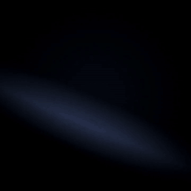

# 🎤 Lyric Video Engine: Dark Kinetic Lyric Videos, Beat-Synced

> Give it a background clip, a song and timed lyrics. Get back an MP4 where every line lands on the vocal, hooks punch in with shake and glow, and the type sits on a dark band over your footage.

[](https://sertaiofficial.com)
[](https://sertaiofficial.com)
[](#example-dark-sample)
[](https://www.youtube.com/@sertai.official)
[](LICENSE)

<p align="center">
  <a href="examples/dark-sample/sample.mp4"></a>
</p>

<p align="center"><em>9-second trial render, <code>dark</code> style (<a href="examples/dark-sample/sample.mp4">MP4 with audio</a>).</em></p>

**One JSON file is the whole edit.** Each lyric line gets a start time, an emphasis flag and a shake level. The renderer reads the song's beats, punches each line onto the screen at its timestamp, shakes and glows the hooks, fades lines out before the next one lands, and encodes the result with the original audio. No timeline editor, no auto-captions that miss rap flows or non-English lyrics. Built by SERTAI LAB for independent artists who release their own videos.

## Easiest way to use it (no API, no code)

Open [`SKILL.md`](SKILL.md), copy the text and paste it into any AI chat assistant you already use.
Paste your lyrics and tell it where the hooks are.
It returns a timed `lyrics.json` with emphasis and shake marked, ready for the renderer, or as a cue sheet you can follow in any video editor.
The script steps below are optional, for people who want the render automated.

## Quick start (automated render)

Requirements: Python 3.9+, ffmpeg, and a bold TrueType font (Liberation Sans Bold is used by default).

```bash
git clone https://github.com/sertaiofficial-ops/lyric-video-engine.git
cd lyric-video-engine
pip install -r requirements.txt
# Debian/Ubuntu: sudo apt-get install ffmpeg fonts-liberation

# 1. Read the song's tempo, beats and onsets
python3 scripts/detect_beats.py song.mp3 beats.json

# 2. Write lyrics.json (see references/lyrics_format.md)

# 3. Render
python3 scripts/render_lyric_video.py background.mp4 song.mp3 lyrics.json output.mp4
```

## How it works

1. **Beats.** [`detect_beats.py`](scripts/detect_beats.py) returns BPM, beat times and onset times, so you can snap each line to a real hit instead of a guessed grid.
2. **Timing.** In `lyrics.json` every line has `start`, `text`, `emphasis` and `shake`. A line stays on screen until the next one starts.
3. **Render.** [`render_lyric_video.py`](scripts/render_lyric_video.py) extracts the background frames, darkens a soft band behind the text, and animates each line:
   - **Punch-in:** the line scales from 30% to full size over `punch_duration`.
   - **Shake:** during the punch, the line jitters by `shake × shake_intensity` pixels.
   - **Glow and drift:** emphasis lines get a halo and a slow breathing motion while they hold.
   - **Fade:** the band fades out near the end of each line.
4. **Encode.** Frames and the audio (trimmed to the clip length) are encoded to H.264/AAC MP4.

### Style presets

| Preset | Use when | Look |
|--------|----------|------|
| `dark` | Noir, melancholy, rap ballads | Gray glow, 60% band, white type |
| `neon` | Electronic, energetic | Cyan glow, 40% band, electric type |
| `minimal` | Clean, editorial | No glow, 30% band, clean type |

Every parameter (resolution, fps, font sizes, band position, punch length, shake strength, fade point, font) is listed in [`references/lyrics_format.md`](references/lyrics_format.md).

## Example: dark sample

The GIF above was rendered with the scripts in this repo. Background and beat are generated with ffmpeg, so the example is fully reproducible and contains no third-party media.

```json
{"start": 1.5, "text": "but I am still awake", "emphasis": false, "shake": 1},
{"start": 3.0, "text": "NO WAY BACK",          "emphasis": true,  "shake": 4},
{"start": 4.5, "text": "lights go out",         "emphasis": false, "shake": 0},
{"start": 6.0, "text": "HEAR THE SIGNAL",      "emphasis": true,  "shake": 5}
```

| Input | Output |
|-------|--------|
| [`lyrics.json`](examples/dark-sample/lyrics.json): 6 lines, 2 hooks | [`sample.mp4`](examples/dark-sample/sample.mp4): 9 s, 720×720, 30 fps |
| [`make_inputs.sh`](examples/dark-sample/make_inputs.sh): dark gradient clip + 120 BPM beat | [`beats.json`](examples/dark-sample/beats.json): 120.2 BPM, 17 beats |

Reproduce it: see [`examples/dark-sample/README.md`](examples/dark-sample/README.md).

## Repository layout

```
lyric-video-engine/
├── SKILL.md                     # Timing rules and workflow (paste into any AI chat)
├── references/
│   └── lyrics_format.md         # Full lyrics.json parameter reference
├── scripts/
│   ├── detect_beats.py          # Tempo, beat and onset detection
│   └── render_lyric_video.py    # Kinetic typography renderer
├── examples/
│   └── dark-sample/             # Trial render: inputs, lyrics.json, MP4, GIF
├── requirements.txt
└── LICENSE
```

## Tips

- Keep the type below any template watermark on your background: move `text_y` and `band_top` down.
- For songs longer than about three minutes, render in two parts and join them, to save memory.
- End with a `" "` line to clear the screen before the outro.

## License

Built by SERTAI LAB · [sertaiofficial.com](https://sertaiofficial.com) · YouTube [@sertai.official](https://www.youtube.com/@sertai.official)

Released under the [MIT License](LICENSE). © 2026 SERTAI LAB.
