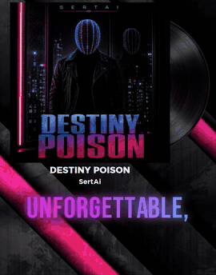
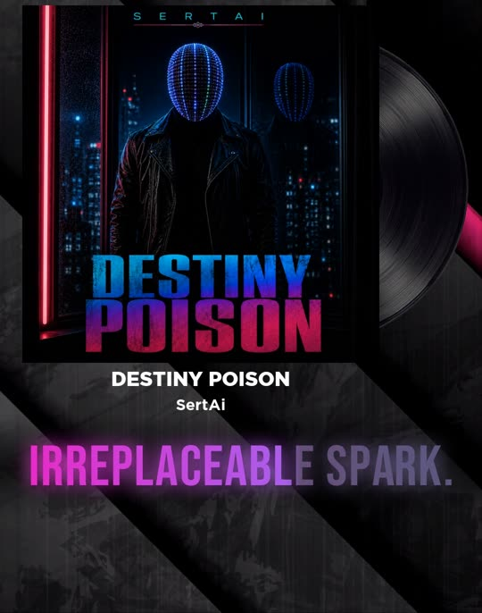

# Example: Destiny Poison (9:16 promo)

A 19-second vertical promo for **Destiny Poison** by SERTAI, rendered over the release's own
promo clip (cover art with a spinning vinyl, title and artist name under the cover).

<p align="center">
&nbsp;</p>

The source clip, the song and the full render are not in the repo (they belong to the release);
`preview.gif` is a 3-second excerpt and `poster.jpg` a single frame, both cropped to the cover and lyric area.

## What it shows

| Element | Setting |
|---------|---------|
| Verse font | Montserrat SemiBold, 64 px (`font_normal`) |
| Hook font | Bebas Neue, 150 px, slight letter spacing (`font_emphasis`) |
| Verse colour | Cyan to violet gradient, a little more violet on every line (`color` per line), blended from the previous line over 0.45 s (`color_blend`), drifting slowly (`gradient_speed`) |
| Hook colour | Pink to magenta, turning magenta to cyan over the line (`color_to`), with the word sweep: each word lights up as it is sung (`words`) |
| Glow | In the text's own colours (`"glow_color": "text"`), strong on hooks, faint on verses |
| Entry | Verses `fade_rise`; the second section opens with `blur_in`; hooks `tracking_in` with a 5% `punch` and shake on the beat |
| Exit | `fade` over 0.35 s; the last hook `blur_out` into the outro |
| Layout | Text centred at y 1590 in a soft band (1480–1700): under the cover title, above the bottom 12% platform UI |

## Timing

- Line starts were placed at the vocal entries, then tightened with
  `snap_to_beats.py --hook-grid beats` (verses to vocal onsets, hooks to the beat).
- Word times for the two hooks come from the vocal take: `UNFORGETTABLE,` 13.96–14.78 s,
  `IRREPLACEABLE` 16.20–17.30 s, `SPARK.` 17.30–17.90 s.
- The cover title slides up through the lower empty zone between about 1.2 and 2.0 s. The first
  line therefore sits in the empty top area (`"y": 380`) for its whole run (0.59–2.91 s), so it can
  land on the first word without colliding with the title. From the second line on, the lyrics
  live under the title.

## Files

| File | What it is |
|------|------------|
| [`lyrics.json`](lyrics.json) | Timed lines with per-line colours, animations and hook word timings |
| [`preset.json`](preset.json) | Layout and look: fonts, gradients, glow, band, default animations |
| [`preview.gif`](preview.gif) | 3-second excerpt of the render (hooks) |
| [`poster.jpg`](poster.jpg) | One frame of the render |

## Render it with your own clip

From the repo root, with a 9:16 background that carries the song:

```bash
python3 scripts/render_lyric_video.py promo.mp4 promo.mp4 examples/destiny-poison/lyrics.json destiny_poison_lyric.mp4 \
  --preset examples/destiny-poison/preset.json
```

Check single frames first with `--stills 1.0,7.5,14.5,17.4 --stills-dir stills`.
For a different background, move `text_center_y`, `band_top` and the first line's `y` to that
clip's empty zones.

Built by SERTAI LAB.
